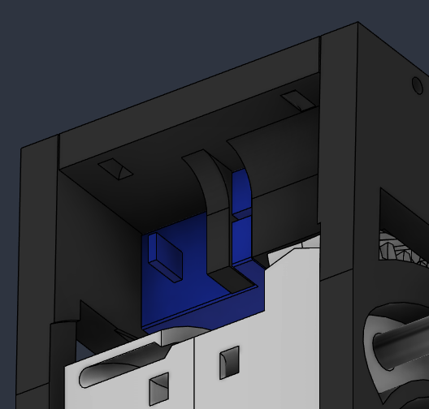
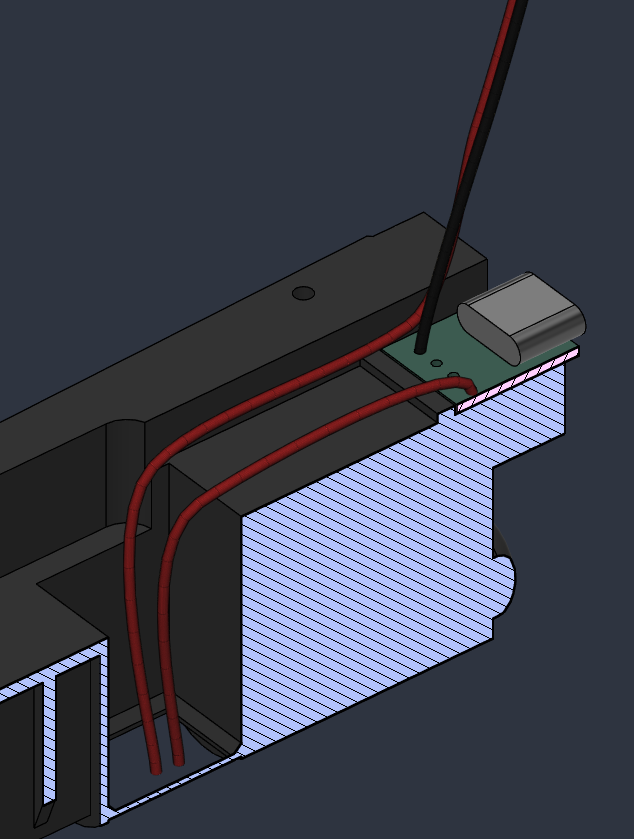
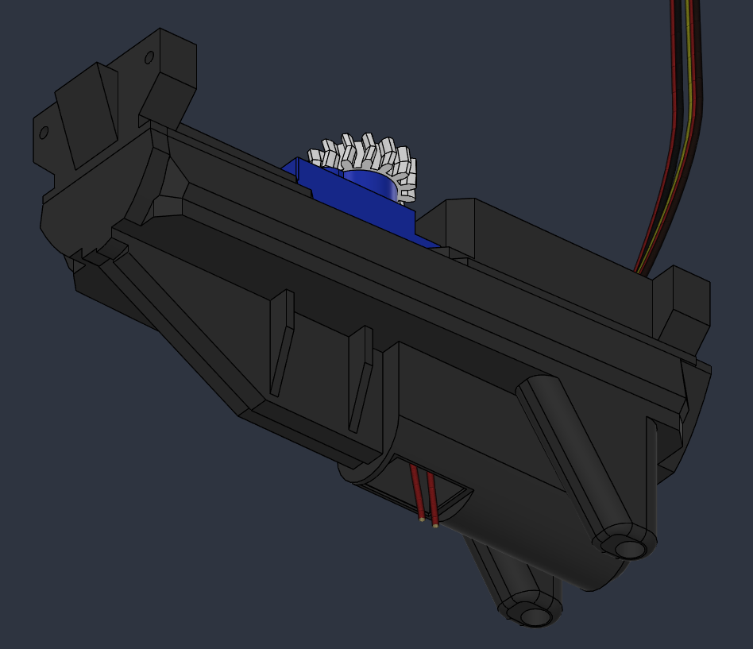
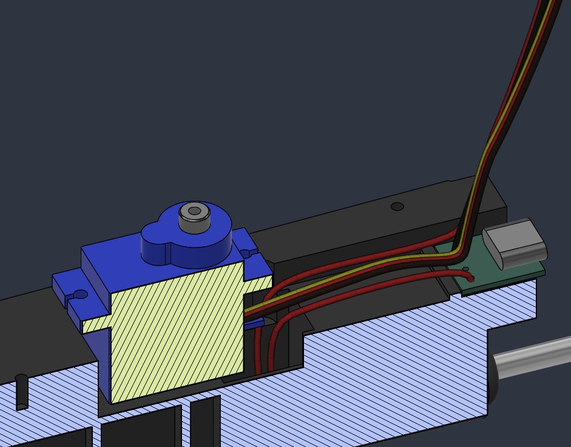
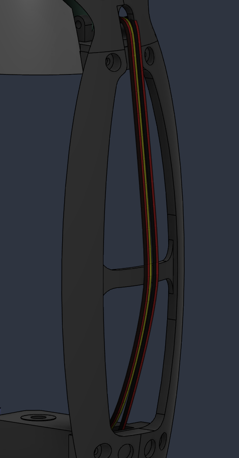
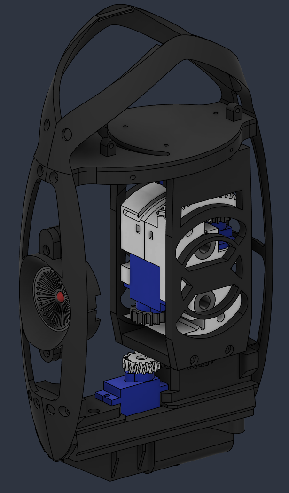
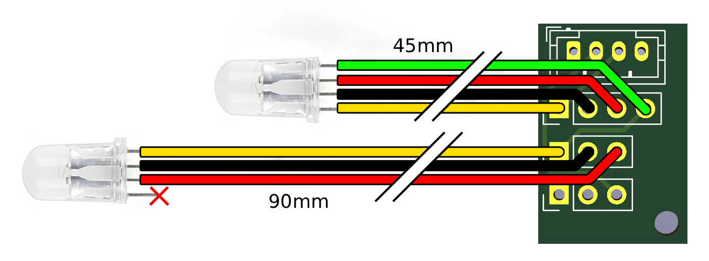
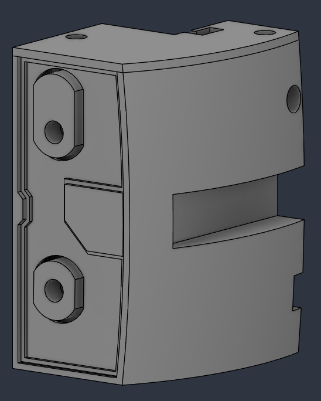

# Portal Turret v4

A Portal-style turret powered by an ESP32-S3 (Lolin S3 Mini). It detects people with a mmWave radar, opens its wings, extends its guns and tracks targets, complete with sound and lights.


## Repository layout

| Folder | Contents |
| --- | --- |
| `src/` | Firmware (PlatformIO, Arduino framework) |
| `data/` | LittleFS image: audio clips and web UI |
| `3d/` | 3D model (`model.step`) |
| `gerber/` | PCB manufacturing files (MainBoard, DaughterBoard) |
| `images/` | Build guide photos |

## Bill of materials

- Lolin Wemos S3
- LD2450 Radar Sensor
- OH49E Hall Effect Sensor - SS49E compatible
- ADXL345 Digital 3-axis Accelerometer Module
- MAX98357 Audio amp
- SN74AHCT125N 4-channel Level Converter
- Small rocker switch

- SK6812 Digital 5050 RGB LED Ring
- 4 SG90 180 servo
- 2 SG90 360 servo
- 5 WS2812 5mm LED

- 604ZZ Ball Bearing - 4x12x4mm
- MYT LM6LUU Linear Ball Bearing - 2 pieces (35mm length)
- 4mm steel rod
- 6mm steel rod

- JST PH crimp set OR JST PH headers and pre-crimped JST PH cables
- Pin headers
- 2mm wood screws

## Steel Rod Sizes

For the 4mm rods:
- 1x 150mm (enforcing the rear leg)
- 2x 55mm (enforcing the front legs)
- 2x 60mm (wings)
- 1x 43mm (x-axis axle)
- 1x 20mm (z-axis bottom axle)
- 1x 10mm (z-axis top axle)

The bended rods for the legs do not have a very precise length. It's best to bend and cut to length after bending, as this makes the process of getting the correct shape a lot easier.

For the 6mm rods:
- 2x 60mm (wings)

## 3D printing

STEP file contains all 3D printed parts. Separate parts in correct print orientation might come later.

## Electronics

Gerber files are included. Order from your favorite PCB manufacturer.

## Assembly guide

Here's raw screenshots. Explicit information comes later.

### X axis

| Notes | Images |
| --- | --- |
| Screw the two halves together. |  |
| Insert the LM6LUU and 604ZZ bearings. Screw the gears on the two 360 servos. |  |
| Solder the wires to the hall sensors. Use shrink tubing to protect the leads. Insert the hall sensors into the slots. The beveled face is the front and should point towards the space where the rack gears will slide. |  | 
| Tuck the wires underneath the little lip. This should help with keeping the hall sensors in place. If they don't want to stay seated, a drop of superglue should help. |  | 

### Z axis
| Notes | Images |
| --- | --- |
| Screw on the X Axis gear on a 180 servo. Slide it in place and use the channels to screw it down. |  |
| Attach one side. |  |
| Slide a 4mm rod through the X axis. Add a 4mm shim on both sides. There is a slot in the frame where the rod should fit. |  |
| Scew on the bottom and the other side. |  |
| Use a ziptie to manage all cables. It should hold the following wires: 2 Hall sensors, 2 Wing servos, X Axis servo. |  |

### Bottom
| Notes | Images |
| --- | --- |
| Slide a 180 servo in the mount and screw it secure |  |
| Screw on the Z Axis gear. |  |
| The USB-C board should be glued into place. If you can't get a solid connection with glue, a tiny screw with some heatshrink could be screwed through the D- slot. Make sure the screw does not short D- to ground, hence the heatshrink tubing. Run the wires through the bottom. Make sure to leave enough to route the wires and attach the JST connector. |  |
| Route the two 5V wires to the bottom. One should come from the USB board, the other should go to your power connector. |  |
| The servo wires should also be run through the same channel to go up in the back. |  |
| Run both the servo and power wires through the gantry. Use the little brace to keep them out of the way from the gantry.  |  |

### Eye
| Notes | Images |
| --- | --- |
| Print the flat retina and mold. As PLA gets soft at relatively low temperatures, you can dunk it in boiling water and press it on the mold for the correct shape. Make sure to print the diffuser with very little top/bottom layers and walls, or use transparent filament. Glue in the LED ring and 5mm LED.|  |

### Gantry

| Notes | Images |
| --- | --- |
| The gantry consists of 5 different pieces. This is done so you can print with little to no support material. The eye should click in place and stay there without any glue. |  |
| The whole gantry should screw together and give enough rigidity for the build. |  |
| Slide in the gantry and bottom. Make sure to not rotate your servo when assembling, otherwise you'll risk a very big offset in angle. You can calibrate small offsets in the settings. |  |
| Screw in the last screws on the front and back of the gantry to finish the motion system. |  |

### Guns

| Notes | Images |
| --- | --- |
| Prepare the LED harness. You can either use JST connectors or solder directly to the board. Make sure you double check the pads of the board and the legs of your LEDs. I've found that different brands can have a different order in the legs. Please note that the `Data In` leg should go to the `Data In` pad, NOT the `Data Out` pad. |  |
| Attach the lever to a 180 servo. The lever should be a friction fit. Insert it into the gun casing and run the wire as shown. Note that the LED harness is not shown here, but should already be attached to the board. |  |
| There's a hole in the bottom to fasten the servo with a screw. |  |
| Insert the barrels into their housing. This should be a friction fit. The housing screws on the part with one screw. |  |
| Slide in the bottom LED and run the wires to the side and through the clamp in the front. |  |
| Slide in the top LED and run the wires out the top. |  |
| Rotate the lever so it points forward. |  |
| Carefully slide the barrels over the lever. You might need to bend the housing to get it in place. Note that the pictures shows the wires outside of the clamps, this is a render error. |  |
| Slide the barrels back into the housing. They should slide easily. If not, try to move the lever by hand. If the barrels don't move, check the clearance of your parts. |  |
| The top can now be screwed on. |  |
| The front plate should click in place. |  |

### Wings

| Notes | Images |
| --- | --- |
| Add 1mm magnets to the slots of the wing. Mind the polarity! |  |
| Add 1mm magnets to the slots of the the wing frame. Mind the polarity! |  |
| The gun should slide in the designated slot. |  |
| Attach the rack gear and secure it with a screw. Glue in the 4mm and 6mm steel rods. |  |

### Leg
| Notes | Images |
| --- | --- |
| The legs should be glued together. Use a piece of 4mm rod to strengthen the joint between the "leg" and the "knee" |  |

## Firmware

Built with [PlatformIO](https://platformio.org/) (env `lolin_s3_mini`).

```bash
pio run                # build
pio run -t upload      # flash firmware
pio run -t uploadfs    # flash LittleFS (audio + web UI)
```

OTA updates are possible once the turret is on your network (`turret.local`) or in its own access point ("Portal Turret", `192.168.4.1`).

More info coming soon

## Calibration

More info coming soon